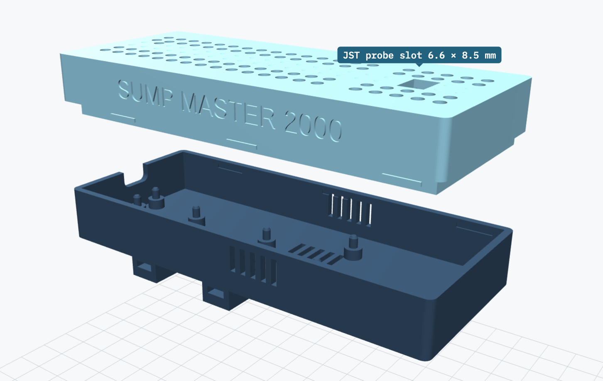
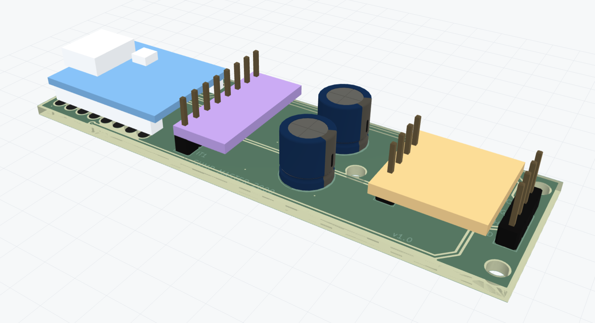
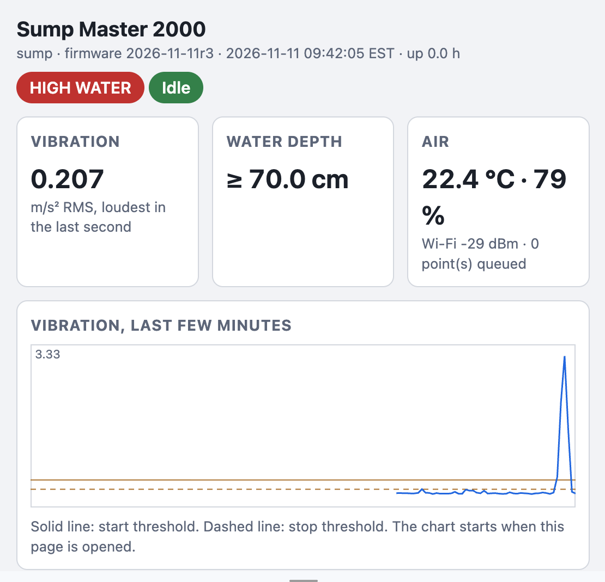

<p>



</p>
<br clear="both"/>

# Sump Master 2000

An ESP32-C3 sump pump monitor. It detects the pump running from its vibration,
measures the water level and the air temperature/humidity, sends everything to
InfluxDB (via Telegraf on the LAN) for a Grafana timeline, and pushes pump
events, alarms and a daily report to your phone with [ntfy.sh](https://ntfy.sh).

There's no cloud service in the data path: readings go to a database on your own
network. [PLAN.md](PLAN.md) has the design and the remaining open questions.

The sketch is `src/sm2k.ino`, with small drivers for the level sensor
(`src/jsn_sr04t.*`) and the AHT20 (`src/aht20.*`).

## What it does

- **Pump on/off:** a GY-346 (ADXL346) accelerometer clamped to the pump or the
  discharge pipe. Samples at 400 Hz, high-passes each axis (~13 Hz cutoff) to
  reject gravity, footsteps and house rumble, and computes RMS over 250 ms
  windows. `RUN_CONFIRM_MS` of continuous vibration above `ON_RMS_THRESHOLD`
  starts a run; `STOP_CONFIRM_MS` of quiet below `OFF_RMS_THRESHOLD` ends it
  (3 s each).
- **Water level:** a JSN-SR04T waterproof ultrasonic sensor under the pit lid.
  Every 5 s it takes the median of a burst of 5 pings (one per 250 ms window, so
  vibration sampling never waits), corrected for the speed of sound at the
  measured air temperature. Level is reported as water depth above the pit
  floor.
- **Temperature/humidity:** an AHT20 on the same I2C bus, read every 10 s and
  CRC-checked.
- **Data to InfluxDB:** pump start/stop as it happens, and every 10 minutes the
  level, temperature, humidity and pump activity. See [Data](#data).
- **ntfy pushes:** see [Notifications](#notifications).
- **A web page on the board** (`http://sm2k.local/`): live readings, the recent
  log, and the calibration settings, changeable from a phone. See
  [Web page](#web-page).
- **OTA updates** pushed from your computer over Wi-Fi, with automatic rollback if the
  new firmware isn't healthy. See [Updating](#updating-firmware).

The onboard NeoPixel (GPIO 8, dimmed) shows the state: **green** = all clear,
**blue** = pump running, **flashing red** = high water with the pump not running,
**flashing purple** = high water with the pump running.

Serial output (115200) prints a status line once a second:
`rms=0.208 max=0.219 loud=0 state=idle level=12.3cm air=17.9C/71% wifi=up tgq=0`
(`rms` is the latest 250 ms window, `max` the loudest of that second, `loud`
how many of its windows reached the stop threshold, `tgq` the number of points
waiting to be sent to Telegraf).

## Hardware and wiring

| Part | Connection |
|------|------------|
| GY-346 (ADXL346) SDA / SCL | GPIO 5 / GPIO 6 |
| AHT20 SDA / SCL | GPIO 5 / GPIO 6 (same bus) |
| JSN-SR04T Trig | GPIO 3 |
| JSN-SR04T Echo | GPIO 4, **straight to the pin** (3.3 V board, no divider) |
| JSN-SR04T VCC / GND | SuperMini 3V3 / GND |
| Status LED | GPIO 8 (onboard NeoPixel) |
| Sensor supply capacitors | 470 µF across 3V3/GND at each I2C sensor |

GPIO 2, 8 and 9 are boot strapping pins on the C3, so nothing else uses them.

**I2C reliability:** the bus runs at **100 kHz**. At 400 kHz, with long jumper
wires and no capacitors, the sensors dropped out and the board sometimes crashed
inside the I2C driver on a cold power-up. Short direct wires plus a 470 µF
capacitor across 3V3/GND at each sensor fixed it (14 hours overnight and 5 of 5
cold power-ups clean). Keep the capacitors.

**GY-346 note:** the ADXL346 is register-compatible with the ADXL345 and uses
the same Adafruit library, but reports device ID `0xE6` rather than `0xE5`, which
the library's `begin()` rejects. The firmware accepts either chip and enables
measurement itself. Its CS and SDO pins can stay unconnected (the module has
pull resistors). The AHT20+BMP280 board's BMP280 (0x77) is unused.

**Level sensor power:** use a **newer JSN-SR04T / AJ-SR04M board that runs from
3.3 V**; its Echo is then 3.3 V and needs no divider. An older 5 V board needs
one: Echo → 1 kΩ → GPIO 4 and GPIO 4 → 2 kΩ → GND. Measure Echo before
connecting it. The firmware enables a weak pull-down on GPIO 4 so a
disconnected Echo can't fire the interrupt from radio noise.
[PLAN.md](PLAN.md#jsn-sr04t-wiring) has the details.

**PCB and case:** the carrier PCB and 3D-printed case are in [hw/](hw/).

**Mounting the level sensor:** the JSN-SR04T is blind closer than about 20-25 cm
and can then report a double echo (about twice the real distance), which would
read as "low" just as the pit overflows. Mount the transducer **at least 30 cm
above the highest level the water can reach** (the pit rim), on a bracket or
riser. Readings closer than 25 cm are treated as "at or above the limit", never
as a real distance.

## Setup

1. **Secrets:**
   ```
   cp src/secrets.h.example src/secrets.h
   cp secrets.ini.example secrets.ini
   ```
   `src/secrets.h` holds Wi-Fi, the Telegraf URL and the ntfy topic;
   `secrets.ini` holds the OTA password (letters and digits), used both to build
   the firmware and to authenticate uploads. Both are git-ignored.
2. **Pit settings** in `platformio.ini` (`[env:sump]`): `SENSOR_TO_FLOOR_CM`,
   `HIGH_WATER_CM`, `HIGH_WATER_HYST_CM`, `MIN_DROP_CM`. The values there are
   placeholders until the sensor is mounted; see [Calibration](#calibration).
3. **InfluxDB, Telegraf and Grafana:** the board needs somewhere to send its
   data. If you don't already run these, follow
   [Setting up InfluxDB, Telegraf and Grafana](#setting-up-influxdb-telegraf-and-grafana)
   below, then put the Telegraf URL in `TELEGRAF_URL`. (Skip it, and leave
   `TELEGRAF_URL` out of `secrets.h`, if you only want the ntfy pushes.)
4. **ntfy:** subscribe to your `NTFY_TOPIC` in the ntfy app.
5. **First flash over USB** (it installs the OTA partition table):
   `pio run -t upload`.

## Updating firmware

After the first USB flash, update over Wi-Fi from your computer:

```
pio run -e sump-ota -t upload
```

- The board is found as `sm2k.local` (change `upload_port` in `platformio.ini` to
  an IP address if mDNS doesn't resolve).
- Updates are only accepted while the pump is idle (an upload pauses sampling
  for ~15 s). If the pump is running the upload fails with no response; run it
  again once the pump stops.
- **Rollback:** a new image runs as a trial. After 3 minutes with Wi-Fi up and
  every sensor that was working before the update working again, it's marked
  good and ntfy says `sump updated A -> B`. If it isn't healthy within 10
  minutes, crashes, or reboots during the trial (including failing to join
  Wi-Fi), the bootloader switches back to the previous firmware and ntfy says
  `update rolled back` with the reason.
- Bump `FIRMWARE_VERSION` in `src/sm2k.ino` for each release.
- Recovery if all else fails: USB flash (`pio run -t upload`).

## Setting up InfluxDB, Telegraf and Grafana

Skip this if you already run them. The data path is:

```
Sump Master  --HTTP POST-->  Telegraf (port 8186)  -->  InfluxDB  <--  Grafana
 (ESP32-C3)                  receives the board's        stores the     draws the
                             data and forwards it        time series    dashboard
```

- **InfluxDB 2.x** is the time-series database that stores the readings.
- **Telegraf** is a small collector. Here it just accepts the board's POSTs and
  writes them to InfluxDB (so the board never needs InfluxDB's token).
- **Grafana** draws the dashboard and sends the "silent" alert.

You need a computer that's always on, on the same network as the board: a
Raspberry Pi, a NAS, a spare PC or a home server. The easiest way to run all
three is Docker.

### 1. Start the three services (Docker)

Install [Docker](https://docs.docker.com/get-docker/), make an empty folder, and
create `docker-compose.yml` in it (change the passwords and token):

```yaml
services:
  influxdb:
    image: influxdb:2
    restart: unless-stopped
    ports: ["8086:8086"]
    volumes: ["influx-data:/var/lib/influxdb2"]
    environment:
      DOCKER_INFLUXDB_INIT_MODE: setup
      DOCKER_INFLUXDB_INIT_USERNAME: admin
      DOCKER_INFLUXDB_INIT_PASSWORD: change-this-password
      DOCKER_INFLUXDB_INIT_ORG: home
      DOCKER_INFLUXDB_INIT_BUCKET: sump
      DOCKER_INFLUXDB_INIT_ADMIN_TOKEN: change-this-admin-token

  telegraf:
    image: telegraf
    restart: unless-stopped
    ports: ["8186:8186"]
    depends_on: [influxdb]
    volumes: ["./sump.conf:/etc/telegraf/telegraf.conf:ro"]
    environment:
      INFLUX_URL: http://influxdb:8086
      INFLUX_ORG: home
      INFLUX_BUCKET: sump
      INFLUX_TOKEN: change-this-admin-token   # replace with a write-only token (step 2)

  grafana:
    image: grafana/grafana-oss
    restart: unless-stopped
    ports: ["3000:3000"]
    depends_on: [influxdb]
    volumes: ["grafana-data:/var/lib/grafana"]

volumes:
  influx-data:
  grafana-data:
```

Copy this project's `telegraf/sump.conf` into the same folder, then run
`docker compose up -d`. InfluxDB is now at `http://<server>:8086` (log in as
`admin`), Grafana at `http://<server>:3000` (first login `admin` / `admin`, it
asks you to change it).

Not using Docker? Install the three packages for your OS from their websites
(InfluxDB 2.x, Telegraf, Grafana), create an organisation and a bucket in
InfluxDB's setup page, copy `telegraf/sump.conf` to
`/etc/telegraf/telegraf.d/`, and put the variables from
`telegraf/sump.env.example` in Telegraf's environment file
(`/etc/default/telegraf` on Linux), then restart Telegraf.

### 2. Make two tokens in InfluxDB

In the InfluxDB web page (port 8086): **Load Data > API Tokens > Generate API
Token > Custom API Token**.

1. A token with **Write** access to the `sump` bucket only. Put it in Telegraf's
   `INFLUX_TOKEN` (replacing the admin token in the compose file) and run
   `docker compose up -d` again.
2. A token with **Read** access to the `sump` bucket, for Grafana (step 4).

### 3. Check Telegraf is listening

From any computer on the network (replace `<server>`):

```
curl -i -X POST http://<server>:8186/sump --data-binary 'sump_test,device=curl value=1'
```

`HTTP/1.1 204 No Content` means it worked. (If you get a connection error,
check the server's firewall allows port 8186.) Then set the URL in
`src/secrets.h`:

```
#define TELEGRAF_URL "http://<server>:8186/sump"
```

and flash the board. Within a minute you should see a `sump_boot` point: in
InfluxDB, **Data Explorer > sump bucket > `sump_boot`**, or in Grafana's Explore.
The 10-minute `sump` readings and pump events follow. If nothing appears, the
board's serial output says `[tg] ...` for each send and names the error (e.g.
"connection refused" means the address or port is wrong).

### 4. Add the dashboard to Grafana

1. In Grafana (port 3000): **Connections > Data sources > Add data source >
   InfluxDB**. Set **Query language** to **Flux**, **URL** to
   `http://influxdb:8086` (Docker) or `http://<server>:8086`, and under **InfluxDB
   Details** enter your organisation (`home`), the default bucket (`sump`) and
   the **read** token. Click **Save & test**.
2. **Dashboards > New > Import**, upload `grafana/sump-dashboard.json`, pick the
   data source you just made, and import.
3. Open the dashboard's settings > Variables and set `bucket` to `sump`, and
   `high_water_cm` / `min_drop_cm` to the same values as the firmware's
   `HIGH_WATER_CM` / `MIN_DROP_CM`.

To add the "silent" alert too, see [Grafana](#grafana) below; the data source
UID it asks for is the last part of the data source's page URL
(`.../connections/datasources/edit/<uid>`).

## Data

The board POSTs InfluxDB line protocol to Telegraf's `http_listener_v2`
(`TELEGRAF_URL`), timestamped with its own NTP-synced clock, so late or buffered
points land at the right time. All points are tagged `device=sump`.

| Measurement | When | Fields |
|---|---|---|
| `sump` | every 10 min, on the clock | `level_cm`, `distance_cm`, `level_status` (`ok`/`near_limit`/`missing`), `temp_c`, `humidity`, `running`, `pump_sensor` (1 = accelerometer answering), `cycles` and `run_s` (for the 10 minutes), `rssi`, `heap`; vibration for the 10 minutes: `rms_idle_avg`, `rms_idle_max`, `rms_run_avg`, `rms_run_min` (each only when there were such readings), and the thresholds in force, `rms_on`, `rms_off` |
| `sump_event` | pump start/stop | `event`, `running`, `seconds` (stop), `rms_avg` and `rms_min` (stop: that run's vibration), `level_cm` (start); `note="restart"` on a post-reboot correction, `note="sensor_lost"` if the accelerometer dropped out mid-run |
| `sump_cycle` | after each run | `seconds`, `level_before_cm`, `level_after_cm`, `drop_cm`, `result` (`ok`/`no_drop`/`unverified`) |
| `sump_alarm` | high water on/off | `type`, `active`, `level_cm` |
| `sump_boot` | each boot | `version`, `reason` |
| `sump_config` | settings changed on the web page | `rms_on`, `rms_off`, `run_confirm_s`, `stop_confirm_s`, `floor_cm`, `high_water_cm`, `hyst_cm`, `min_drop_cm` |

If Telegraf can't be reached, points queue on the board (150 lines, about a day
of readings plus events) and are sent in order when it's back; if the queue
fills, the oldest are dropped. The queue is in RAM, so a reboot loses it.

## Grafana

**Dashboard** (`grafana/sump-dashboard.json`, InfluxDB 2.x with Flux): import it
(Dashboards > New > Import), pick your InfluxDB (Flux) data source, then set the
`bucket` variable. Keep the `high_water_cm` and `min_drop_cm` variables equal to
the firmware's `HIGH_WATER_CM` and `MIN_DROP_CM`. All panels share one time
axis:

- Current values: pump on/off, water depth, air temperature, humidity, pump
  cycles in the range, and time since the last data.
- Pump and high-water state timeline.
- Water depth, with the level before and after each pump run and a dashed
  high-water line.
- Run time per cycle and level drop per cycle (a slow rise in run time, or a
  shrinking drop, is an early warning).
- Pump cycles and run time per day (US Eastern days).
- Temperature and humidity.
- Tables of recent pump cycles and of alarms and reboots, plus high-water and
  reboot annotations on every graph.
- Board health: Wi-Fi RSSI and free heap.

The JSON is generated by `tools/make_dashboard.py`: edit that and re-run it
rather than editing the JSON by hand.

**"Sump monitor silent" alert** (`grafana/sump-alerting.yaml`): fires to ntfy
when no sump data has arrived for 30 minutes, which covers what the board can't
report itself (no power, no Wi-Fi, Telegraf down, a hang). It sends a
"resolved" push when data returns.

- **Provisioning:** fill in the three `CHANGE_ME` values (ntfy topic, data
  source UID, bucket), copy the file to Grafana's `provisioning/alerting/`
  directory and restart Grafana. The rule routes to its own contact point, so
  your notification policies are untouched.
- **Or in the UI:** create a Webhook contact point with the URL
  `https://ntfy.sh/<topic>?template=grafana&ta=warning` (ntfy's built-in
  Grafana template turns the webhook JSON into a normal push; don't put `{{ }}`
  placeholders in the URL, Grafana tries to evaluate them itself). Then
  create an alert rule on the Flux query in the YAML file, with the condition
  "A is below 1", evaluated every 5 minutes, "Alert state if no data" set to
  **Alerting**, and the contact point selected under notifications.

## Notifications

All pushes go to `NTFY_TOPIC` (leave it out of `secrets.h` to disable them; they
are then only logged). They're queued and retried if the internet is down.

| Push | Priority |
|---|---|
| `sump started` / `sump stopped` in real time; the stop includes the run time, e.g. `Stopped at 2026-09-24 09:12:30 EDT (ran 28.8 s)` | default |
| **High water**: as soon as the level passes `HIGH_WATER_CM` (or reaches the sensor's limit), then every 30 minutes until it falls `HIGH_WATER_HYST_CM` below, then one "all clear" | urgent |
| **Pump ran but the level didn't drop** by `MIN_DROP_CM`: before/after levels and run time (clogged discharge, stuck check valve, pump running dry). If there was no level reading around the run: "can't verify" | high |
| **Daily report** just before the 3 AM reboot: pump state, water level, temperature and humidity, cycles/run time/longest run/highest water since the last report, firmware version | low (silent) |
| Sensor not responding (accelerometer, level sensor, AHT20), and recovered | high |
| Telegraf unreachable for 30 minutes, and reachable again | default |
| Exception reboots with the reason, e.g. `sump rebooted: WiFi down watchdog (reboot #2)` | default |
| OTA updated / rolled back | default / high |

ntfy.sh has per-IP rate and daily message limits for anonymous use, shared with
anything else on your public IP. Every pump cycle is two pushes, so check the
limits against a heavy wet-season day.

## Reliability

The firmware recovers on its own where possible and never fails silently.

| Mechanism | Behavior |
|-----------|----------|
| **Bounded Wi-Fi connect at boot** | If Wi-Fi isn't up within 30 s, reboot and retry instead of hanging. |
| **Wi-Fi watchdog** | If Wi-Fi drops it resets the radio and retries every 30 s; if it stays down for 2 minutes, reboot. |
| **Telegraf outage** | Doesn't reboot (that can't fix the server): data queues and one push says so. |
| **Accelerometer optional** | Every 30 s the accelerometer's device ID is read (without this a dead sensor reads as zeros and looks like an idle pump). If it's missing at boot, or fails three checks in a row, the board **keeps running without it**: pump on/off detection pauses, while water level, alarms, reporting and OTA carry on. One push says so, it's retried every 30 s with I2C bus recovery (clocking SCL to release a bus a sensor is holding low), and a push says when it's back. A run in progress when it drops out is closed with `note="sensor_lost"` and no run time. |
| **Level and AHT20 watchdogs** | Push an alert when there's been no reliable echo for 2 minutes, or no AHT20 reading for 5 minutes, and again when they recover. |
| **Suspect level readings** | A jump of more than 15 cm between readings is held until the next reading confirms it. |
| **Task watchdog** | A 30 s hardware watchdog resets a hung main loop; the reset is reported on the next boot. |
| **Nightly reboot** | 3 AM local time (`REBOOT_HOUR`, US Eastern via `TZ_STRING`, DST-aware) to guard against slow heap fragmentation, after sending the daily report. Held off while the pump runs, high water is active, a push is waiting or an OTA trial is running. The "already rebooted today" day is stored in flash so it can't reboot-loop within the hour. |
| **Unexpected reset detection** | A crash, watchdog or brownout reset is detected on the next boot and pushed. Power cycles, the reset button, flashing and deliberate restarts are not. |
| **Stuck "running" correction** | If the board reboots mid-run and the pump is idle 15 s after boot, a `stop` (with `note="restart"`, no run length) is recorded and pushed so nothing implies it's still running. |

## Web page

Open `http://sm2k.local/` (or the board's IP address, printed at boot as
`[web] ready`) from a phone or computer on the same network. No laptop or USB
cable is needed once the board is installed.

- **Live readings**, refreshed every 2 seconds: pump state, vibration, water
  depth, air temperature and humidity, Wi-Fi signal, and a chart of the last
  few minutes of vibration against the two thresholds.
- **Calibration readings:** the idle vibration since the last restart (average
  and peak), the last pump run (average and lowest), and suggested thresholds.
- **Settings** (below), saved on the board. Saving asks for a user name and
  password: `admin` and the OTA password from `secrets.ini`. It uses HTTP
  digest authentication, so the password itself isn't sent over the network.
- **Log:** the last 120 log lines (everything the serial output shows except
  the once-a-second status line).

Viewing needs no password; anyone on your network can see the readings and the
log. The page is not reachable from the internet unless you set up a VPN.

Plain-data endpoints, if you want to script against it: `GET /api/status`
(JSON) and `GET /api/log?since=N` (text; the first line is the line count to
pass back as `since`).

## Calibration

Every calibration value can be changed on the [web page](#web-page) without
reflashing. The values in `platformio.ini` are the defaults a board starts with
(and returns to with **Reset to defaults**); saved values survive restarts and
firmware updates.

| Setting | Default (`platformio.ini`) |
|---|---|
| Pump start / stop threshold (m/s² RMS) | `ON_RMS_THRESHOLD` 0.50 / `OFF_RMS_THRESHOLD` 0.30 |
| Seconds of vibration / quiet to count as started / stopped | `RUN_CONFIRM_MS` / `STOP_CONFIRM_MS`, 3 s each |
| Sensor to pit floor (cm) | `SENSOR_TO_FLOOR_CM` |
| High-water alarm depth, and how far below it clears (cm) | `HIGH_WATER_CM`, `HIGH_WATER_HYST_CM` |
| A run should lower the water by (cm) | `MIN_DROP_CM` |

- **Vibration thresholds:** let the pump run once, then read the web page's
  calibration readings: both thresholds belong between the idle average and
  the last run's lowest value (the page suggests a pair). The Grafana panel
  "Vibration: idle and running, against the thresholds" shows the same over
  days: both dashed lines should stay above the idle readings and below
  "Running lowest". The board on a desk idles at about 0.2 m/s².
- **Pit:** set the sensor-to-floor distance to the measured distance from the
  sensor to the empty pit floor (the page shows the current sensor-to-water
  distance). Every pump run is logged (and stored in `sump_cycle`) as
  `Pump cycle: on at X cm, off at Y cm, dropped Z cm`, so after a few real
  cycles set the high-water depth a few cm above the normal "on" level and the
  expected drop well below the normal drop.
- A settings change is recorded in InfluxDB (`sump_config`) and marked on the
  dashboard.

## Notes and gotchas

- Wi-Fi TX power is set to 15 dBm (`WIFI_TX_POWER`). This was needed on older
  ESP32-C3 SuperMini boards, which joined Wi-Fi on only about 1 in 3 boots at
  full power; **the newer "v2" boards with an external antenna don't have that
  problem and don't need it**. 15 dBm is a safe default; only lower it (e.g.
  `WIFI_POWER_8_5dBm`) if your board is flaky joining Wi-Fi.
- Log lines are timestamped (wall-clock time once NTP syncs, uptime before
  that) and the boot banner prints `FIRMWARE_VERSION`.
- The platform is pinned (`55.03.37`) because the unpinned "stable" release's
  esptool crashed mid-upload; don't unpin it.
- The USB port name changes each time the board re-enumerates; close any
  serial monitor before flashing, and restart the monitor after the board
  reboots.
